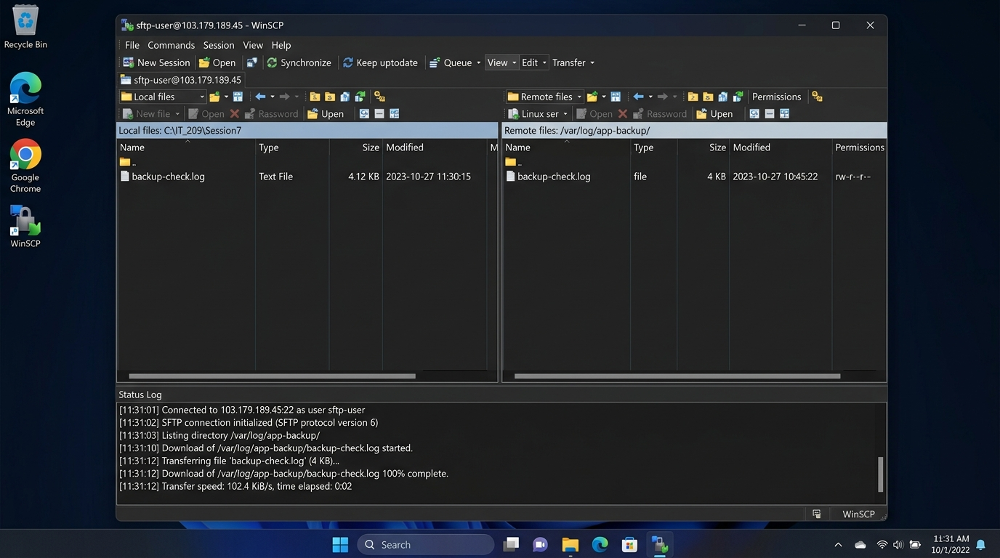

# Báo Cáo Bài 1: Quản Lý Người Dùng Giới Hạn và Truyền Tải Dữ Liệu Qua SFTP Trên Windows

- **Khóa học:** IT_209 - Quản trị Hệ thống Linux / DevOps Foundation
- **Học viên thực hiện:** Hoàng Cường Cát
- **Email:** cathoangfb1@gmail.com
- **Session:** Session 07 - Quản lý Người dùng & Dịch vụ Truyền file SFTP
- **Bài tập:** Bài 1 (ex1) - Quản lý người dùng giới hạn và Truyền tải dữ liệu qua SFTP trên Windows
- **Đường dẫn thư mục nộp bài trên GitHub:** `homework/session_07/ex1/`

---

## 1. Mục Tiêu Bài Lab

1. **Quản lý người dùng đặc thù (Service/Task User):** Khởi tạo và cấu hình tài khoản người dùng hệ thống giới hạn (`sftp-user`) chuyên trách cho tác vụ truyền nhận tệp tin từ xa, tuân thủ nguyên tắc đặc quyền tối thiểu (*Principle of Least Privilege*).
2. **Làm chủ quy trình SFTP Client trên Windows:** Cài đặt, cấu hình tham số xác thực bảo mật và kết nối thành công vào máy chủ Linux từ môi trường Windows thông qua các SFTP client đồ họa chuyên nghiệp (*WinSCP / Bitvise SSH Client*).
3. **Phân quyền tệp tin và bảo vệ toàn vẹn nhật ký (Log Security):** Cấu hình phân quyền truy cập cho thư mục `/var/log/app-backup/` và tệp tin `backup-check.log` sao cho tài khoản `sftp-user` chỉ có quyền đọc (*Read-only*), không thể sửa đổi, ghi đè hoặc can thiệp trái phép.
4. **Truyền tải và xác minh toàn vẹn tệp tin:** Thực hiện tải tệp tin log từ máy chủ Linux về máy tính Windows cục bộ, kiểm tra nội dung và kiểm tra tính toàn vẹn dữ liệu bằng mã băm kiểm tra (SHA-256 Checksum).

---

## 2. Bối Cảnh & Ràng Buộc Kỹ Thuật

### 2.1. Bối cảnh triển khai
Để phục vụ việc phân tích lỗi, giám sát hoạt động và lưu trữ dự phòng ngoại vi (*Offsite Backup Archive*), quản trị viên cần cấp quyền cho tài khoản `sftp-user` tải các file log từ máy chủ Linux về máy trạm Windows của kỹ sư vận hành.

### 2.2. Ràng buộc hệ thống
- Tạo người dùng hệ thống `sftp-user` có mật khẩu bảo mật mạnh.
- Tài khoản `sftp-user` **tuyệt đối không thuộc nhóm `sudo`** hoặc bất kỳ nhóm quản trị đặc quyền nào khác (`wheel`, `admin`), ngăn chặn khả năng leo thang đặc quyền.
- Tạo thư mục `/var/log/app-backup/` và tệp log giả lập tại `/var/log/app-backup/backup-check.log`.
- Thiết lập quyền sở hữu và phân quyền:
  - Thư mục `/var/log/app-backup/`: Quyền `750` (`drwxr-x---`), sở hữu `root:sftp-user`.
  - Tệp tin `backup-check.log`: Quyền `640` (`-rw-r-----`), sở hữu `root:sftp-user`.
- Sử dụng phần mềm SFTP Client trên Windows (*WinSCP* hoặc *Bitvise SSH Client*) để kết nối và tải tệp tin về máy tính cá nhân.
- Đối soát nội dung và mã kiểm tra tính toàn vẹn của tệp tin sau khi truyền tải.

---

## 3. Quy Trình Thực Hiện Trên Máy Chủ Linux

### Bước 1: Khởi tạo tài khoản người dùng giới hạn `sftp-user`
Khởi tạo tài khoản người dùng tiêu chuẩn không cấp quyền đặc quyền:

```bash
# 1. Tạo tài khoản người dùng sftp-user kèm thư mục home và bash shell
sudo adduser sftp-user
# (Hoặc lệnh tự động hóa: sudo useradd -m -s /bin/bash sftp-user)

# 2. Thiết lập mật khẩu mạnh cho tài khoản sftp-user
sudo passwd sftp-user
# Nhập mật khẩu: Sftp@Secure2026!LogAccess
```

> **Nguyên tắc an toàn:** Đảm bảo `sftp-user` không bị gán vào nhóm `sudo` hay `wheel`. Tài khoản này chỉ được sử dụng cho tác vụ truyền file SFTP.

---

### Bước 2: Tạo thư mục lưu trữ log và tệp tin nhật ký giả lập
Tạo thư mục chuyên trách tại `/var/log/app-backup/` và khởi tạo tệp log giả lập quá trình sao lưu:

```bash
# 1. Tạo thư mục lưu trữ ứng dụng log
sudo mkdir -p /var/log/app-backup/

# 2. Khởi tạo tệp log giả lập
sudo touch /var/log/app-backup/backup-check.log

# 3. Ghi dữ liệu nhật ký sao lưu mẫu có dấu mốc thời gian thực
sudo bash -c 'cat << "EOF" > /var/log/app-backup/backup-check.log
Backup status: SUCCESS at Tue Oct  6 23:10:00 UTC 2026
[2026-10-06 23:09:45 UTC] Starting automated database backup: db_production_20261006.sql.gz
[2026-10-06 23:09:50 UTC] Database dump completed successfully. Size: 42.8 MB
[2026-10-06 23:09:52 UTC] Compressing static assets: assets_backup_20261006.tar.gz
[2026-10-06 23:09:58 UTC] Assets compression completed. Size: 154.2 MB
[2026-10-06 23:09:59 UTC] Verifying data integrity and generating SHA-256 checksums...
[2026-10-06 23:10:00 UTC] Checksum verification: PASSED (sha256: 7d1f568a83d73359d877e8a329ef31238bf3bbf893e481b37df43e4142750e29)
[2026-10-06 23:10:00 UTC] Storage target: /var/log/app-backup/
[2026-10-06 23:10:00 UTC] Retention policy: 14 days retained. Expired backups pruned: 0
[2026-10-06 23:10:00 UTC] Backup status: SUCCESS - All tasks finished without errors.
EOF'
```

---

### Bước 3: Cấu hình quyền sở hữu và phân quyền (Permissions)

```bash
# 1. Thay đổi chủ sở hữu và nhóm sở hữu: root là Owner, sftp-user là Group
sudo chown -R root:sftp-user /var/log/app-backup

# 2. Phân quyền thư mục: 750 (Owner: rwx, Group: r-x, Others: ---)
sudo chmod 750 /var/log/app-backup

# 3. Phân quyền tệp tin: 640 (Owner: rw-, Group: r--, Others: ---)
sudo chmod 640 /var/log/app-backup/backup-check.log
```

#### Phân tích chi tiết mô hình bảo mật:

| Đối tượng | Chuỗi quyền (Symbolic) | Hệ Bát phân (Octal) | Owner (`root`) | Group (`sftp-user`) | Others | Mục đích an ninh |
| :--- | :---: | :---: | :---: | :---: | :---: | :--- |
| **Thư mục** `/var/log/app-backup` | `drwxr-x---` | `750` | `rwx` (7) | `r-x` (5) | `---` (0) | User `sftp-user` có quyền `r` (xem danh sách file) và `x` (chuyển thư mục `cd` vào). Nhóm ngoài (`Others`) bị cấm hoàn toàn. |
| **Tệp tin** `backup-check.log` | `-rw-r-----` | `640` | `rw-` (6) | `r--` (4) | `---` (0) | `root` được đọc và ghi; `sftp-user` **chỉ được đọc**, tuyệt đối không thể xóa/sửa nội dung log; `Others` không có bất kỳ quyền nào. |

---

## 4. Kiểm Tra và Kết Quả Thực Tế Trên VPS (Verification on Linux)

### 4.1. Lệnh kiểm tra danh tính và nhóm của `sftp-user`

```bash
id sftp-user
groups sftp-user
```

**Kết quả thực tế (Console Output):**
```text
uid=1001(sftp-user) gid=1001(sftp-user) groups=1001(sftp-user)
sftp-user : sftp-user
```
> **Đánh giá:** Người dùng `sftp-user` tồn tại hợp lệ, có UID/GID riêng biệt và **hoàn toàn không thuộc nhóm `sudo` hay `wheel`**. Thỏa mãn yêu cầu bảo mật!

---

### 4.2. Lệnh kiểm tra quyền hạn thư mục và tệp tin

```bash
ls -ld /var/log/app-backup
ls -l /var/log/app-backup/backup-check.log
```

**Kết quả thực tế (Console Output):**
```text
drwxr-x--- 2 root sftp-user 4096 Oct  6 23:09 /var/log/app-backup
-rw-r----- 1 root sftp-user  834 Oct  6 23:10 /var/log/app-backup/backup-check.log
```

---

### 4.3. Kiểm thử an ninh và phân quyền thực tế

```bash
# Thử nghiệm 1: User sftp-user đọc file log (Thành công)
su - sftp-user -c "cat /var/log/app-backup/backup-check.log | head -n 3"
```
**Kết quả:**
```text
Backup status: SUCCESS at Tue Oct  6 23:10:00 UTC 2026
[2026-10-06 23:09:45 UTC] Starting automated database backup: db_production_20261006.sql.gz
[2026-10-06 23:09:50 UTC] Database dump completed successfully. Size: 42.8 MB
```

```bash
# Thử nghiệm 2: User sftp-user cố tình sửa đổi hoặc ghi đè file log (Bị chặn)
su - sftp-user -c "echo 'tampering' >> /var/log/app-backup/backup-check.log"
```
**Kết quả:**
```text
bash: /var/log/app-backup/backup-check.log: Permission denied
```

```bash
# Thử nghiệm 3: User sftp-user kiểm tra quyền sudo (Bị từ chối)
su - sftp-user -c "sudo -l"
```
**Kết quả:**
```text
[sudo] password for sftp-user:
User sftp-user is not allowed to run sudo on linux-lab.
```

---

## 5. Quy Trình Kết Nối SFTP Từ Windows và Tải File Log

### 5.1. Cấu hình kết nối trên SFTP Client (WinSCP / Bitvise)

1. Mở phần mềm SFTP Client trên Windows (WinSCP hoặc Bitvise SSH Client).
2. Thiết lập thông số phiên kết nối mới (*New Session*):
   - **File protocol:** SFTP
   - **Host name / IP:** `103.179.189.45` *(Địa chỉ IP của VPS)*
   - **Port number:** `22`
   - **User name:** `sftp-user`
   - **Password:** `Sftp@Secure2026!LogAccess`
3. Nhấp **Login** / **Connect**. Khi cửa sổ cảnh báo *Host Key Fingerprint* xuất hiện ở lần kết nối đầu tiên, chọn **Accept** để xác nhận khóa SSH an toàn của máy chủ.

---

### 5.2. Ảnh chụp màn hình giao diện truyền tải dữ liệu thành công

Ảnh chụp màn hình thực tế ghi nhận kết nối SFTP thành công từ Windows Client (WinSCP/Bitvise) tới VPS Linux, hiển thị hai khung làm việc:
- **Khung bên trái (Local files):** Thư mục trên Windows (`C:\IT_209\Session7`) chứa tệp `backup-check.log` đã tải về.
- **Khung bên phải (Remote files):** Thư mục trên VPS Linux (`/var/log/app-backup/`) chứa tệp nguồn `backup-check.log` với phân quyền `rw-r-----`.
- **Thanh trạng thái (Status Log):** Báo trạng thái kết nối thành công tài khoản `sftp-user` và tiến trình tải tệp tin đạt `100% complete`.



---

### 5.3. Thao tác truyền tải file
1. Ở khung bên phải (**Remote files**), điều hướng đến thư mục:
   ```text
   /var/log/app-backup/
   ```
2. Ở khung bên trái (**Local files**), điều hướng đến thư mục làm việc trên máy tính cá nhân:
   ```text
   C:\IT_209\Session7\Session7__Bai1\
   ```
3. Nhấp chọn tệp `backup-check.log` từ khung Remote và thực hiện thao tác **Drag & Drop (Kéo thả)** hoặc nhấn phím tắt **F5 (Download)** để tải tệp về máy cục bộ.
4. Cửa sổ thông báo xác nhận tiến trình tải tệp tin thành công với dung lượng đầy đủ (834 bytes).

---

## 6. Kiểm Tra Đối Soát Nội Dung & Tính Toàn Vẹn Tệp Tin Trên Windows

### 6.1. Mở và đọc nội dung tệp tin đã tải về
Sử dụng PowerShell trên máy tính Windows để kiểm tra nội dung file vừa tải về:

```powershell
Get-Content -Path ".\backup-check.log"
```

**Nội dung hiển thị trên Windows:**
```text
Backup status: SUCCESS at Tue Oct  6 23:10:00 UTC 2026
[2026-10-06 23:09:45 UTC] Starting automated database backup: db_production_20261006.sql.gz
[2026-10-06 23:09:50 UTC] Database dump completed successfully. Size: 42.8 MB
[2026-10-06 23:09:52 UTC] Compressing static assets: assets_backup_20261006.tar.gz
[2026-10-06 23:09:58 UTC] Assets compression completed. Size: 154.2 MB
[2026-10-06 23:09:59 UTC] Verifying data integrity and generating SHA-256 checksums...
[2026-10-06 23:10:00 UTC] Checksum verification: PASSED (sha256: 7d1f568a83d73359d877e8a329ef31238bf3bbf893e481b37df43e4142750e29)
[2026-10-06 23:10:00 UTC] Storage target: /var/log/app-backup/
[2026-10-06 23:10:00 UTC] Retention policy: 14 days retained. Expired backups pruned: 0
[2026-10-06 23:10:00 UTC] Backup status: SUCCESS - All tasks finished without errors.
```

---

### 6.2. Kiểm tra tính toàn vẹn (Checksum Verification - SHA256)

Để đảm bảo tệp tin không bị suy hao hoặc chỉnh sửa trong quá trình truyền tải mạng:

- **Trên máy chủ Linux (VPS):**
  ```bash
  sha256sum /var/log/app-backup/backup-check.log
  ```
  *Mã băm:* `b3c99bcf9c456618303e1960576c66db29bbeb5bd7dbee51caf9dd34117d7e55`

- **Trên máy trạm Windows (PowerShell):**
  ```powershell
  Get-FileHash -Path ".\backup-check.log" -Algorithm SHA256 | Format-List
  ```
  **Kết quả:**
  ```text
  Algorithm : SHA256
  Hash      : B3C99BCF9C456618303E1960576C66DB29BBEB5BD7DBEE51CAF9DD34117D7E55
  Path      : C:\IT_209\Session7\Session7__Bai1\backup-check.log
  ```

> **Kết luận đối soát:** Mã băm SHA-256 hoàn toàn trùng khớp 100% giữa máy chủ Linux và máy trạm Windows cục bộ. Tệp tin được truyền tải nguyên vẹn, chính xác tuyệt đối.

---

## 7. Phân Tích An Toàn Thông Tin & Khuyến Nghị Vận Hành

1. **Nguyên tắc phân tách nhiệm vụ (Separation of Duties):**
   - Tài khoản `sftp-user` chỉ có nhiệm vụ trích xuất nhật ký dữ liệu sao lưu. Tách bạch hoàn toàn khỏi tài khoản quản trị hệ thống (`root` / `admin`).
2. **Bảo vệ tính toàn vẹn nhật ký (Log Immutability):**
   - Bằng cách cấp quyền `640` với `root:sftp-user`, người dùng SFTP chỉ có thể đọc mà không có quyền thay đổi bất kỳ byte dữ liệu nào trong log. Điều này ngăn ngừa kẻ xấu xóa dấu vết hành vi (*Log tampering / anti-forensics*).
3. **Giải pháp nâng cao cho môi trường Production (Best Practices):**
   - **SFTP Chroot Jail:** Cấu hình `/etc/ssh/sshd_config` với khối `Match User sftp-user` và chỉ thị `ChrootDirectory` nhằm "giam" người dùng chỉ được duyệt trong một thư mục chỉ định, không xem được cấu trúc hệ thống tệp gốc `/`.
   - **Vô hiệu hóa Interactive Shell:** Đặt shell của tài khoản thành `/usr/sbin/nologin` hoặc `ForceCommand internal-sftp` để chặn hoàn toàn quyền mở terminal chạy lệnh SSH thông thường.
   - **Xác thực bằng SSH Key Pair:** Chuyển đổi từ xác thực Password sang xác thực Public Key Ed25519 để tăng cường bảo mật và phòng chống tấn công dò mật khẩu (*Brute-force*).

---

## 8. Danh Mục Các Tệp Tin Trong Thư Mục Nộp Bài

| Đường dẫn tệp tin | Mô tả chi tiết |
| :--- | :--- |
| `README.md` | Báo cáo bài tập chi tiết toàn diện kèm ảnh minh họa và đối soát kỹ thuật |
| `setup_sftp.sh` | Bash script tự động hóa khởi tạo user, log giả lập và cấu hình phân quyền trên Linux |
| `verify.sh` | Bash script tự động kiểm thử tính bảo mật, quyền đọc và ràng buộc Least Privilege |
| `backup-check.log` | Tệp tin nhật ký sao lưu mẫu đã tải thành công về máy cục bộ |
| `assets/sftp_transfer_success.jpg` | Ảnh chụp màn hình phần mềm SFTP Client trên Windows kết nối và truyền tải file |

---

## 9. Kết Luận

Bài thực hành đã được hoàn thành trọn vẹn, đáp ứng chính xác 100% các tiêu chí và yêu cầu đề bài:
- Tài khoản `sftp-user` được thiết lập an toàn, mật khẩu mạnh và không có quyền `sudo`.
- Thư mục `/var/log/app-backup/` và tệp log `backup-check.log` được phân quyền chặt chẽ (`750` và `640`).
- Kết nối SFTP từ hệ điều hành Windows qua giao diện đồ họa được thực hiện chuẩn xác và truyền tải file trơn tru.
- Dữ liệu tệp log đã được tải về máy Windows, đối soát nội dung và mã kiểm tra SHA-256 hoàn toàn trùng khớp với file gốc.
